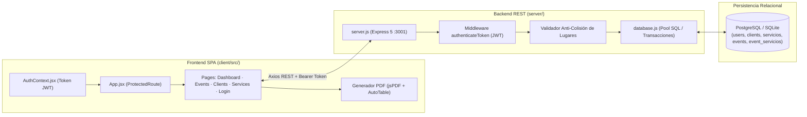
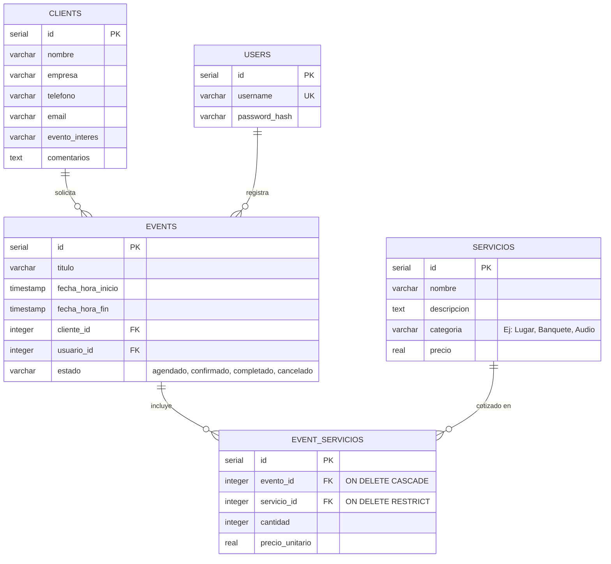

# 📘 Documentación Técnica — Sistema de Gestión de Eventos (`eventos-app`)

**Autor:** Roberto Alejandro Chagra Martínez  
**Versión:** 1.0.0  
**Stack:** React 19 · Vite 8 · Express 5 · PostgreSQL (`pg`) / SQLite3 · JWT · jsPDF  

---

## 1. Arquitectura Cliente-Servidor

El sistema está dividido en dos subsistemas desacoplados que se comunican vía HTTP/JSON autenticados con **JSON Web Tokens (JWT)**:
1. **Cliente SPA ([`client/`](file:///g:/Mi%20unidad/Drive.alumno.udg.mx/Proyectos/eventos-app/client/package.json))**: Aplicación en React 19 con enrutamiento declarativo (`react-router-dom` v7), estado global de sesión ([`AuthContext.jsx`](file:///g:/Mi%20unidad/Drive.alumno.udg.mx/Proyectos/eventos-app/client/src/context/AuthContext.jsx)) y motor de generación de cotizaciones PDF en cliente (`jspdf` + `jspdf-autotable`).
2. **Servidor API REST ([`server/`](file:///g:/Mi%20unidad/Drive.alumno.udg.mx/Proyectos/eventos-app/server/package.json))**: Servidor Express 5 ([`server/server.js`](file:///g:/Mi%20unidad/Drive.alumno.udg.mx/Proyectos/eventos-app/server/server.js)) que gestiona la lógica transaccional, validación de disponibilidad de recintos y persistencia relacional ([`server/database.js`](file:///g:/Mi%20unidad/Drive.alumno.udg.mx/Proyectos/eventos-app/server/database.js)). En producción, sirve además los activos compilados de `client/dist`.

---

## 2. Modelo de Base de Datos y Migraciones

El esquema relacional inicializado en [`server/database.js`](file:///g:/Mi%20unidad/Drive.alumno.udg.mx/Proyectos/eventos-app/server/database.js) consta de 5 tablas principales con integridad referencial:

### Scripts de Migración y Seeding (`server/`)
- **[`server/database.js`](file:///g:/Mi%20unidad/Drive.alumno.udg.mx/Proyectos/eventos-app/server/database.js)**: Crea las tablas si no existen y genera los usuarios iniciales (`admin1`, `admin2`, `admin3`) con hash `bcrypt`.
- **[`server/migrate_events.js`](file:///g:/Mi%20unidad/Drive.alumno.udg.mx/Proyectos/eventos-app/server/migrate_events.js)** y **[`server/migrate_services.js`](file:///g:/Mi%20unidad/Drive.alumno.udg.mx/Proyectos/eventos-app/server/migrate_services.js)**: Utilidades de evolución de esquema para migrar del modelo antiguo de paquetes fijos al modelo flexible de carrito maestro-detalle (`events` + `event_servicios`).
- **[`server/seed_services.js`](file:///g:/Mi%20unidad/Drive.alumno.udg.mx/Proyectos/eventos-app/server/seed_services.js)**: Inserta el catálogo base de recintos, mobiliario y banquetes.

---

## 3. Especificación de Endpoints REST ([`server/server.js`](file:///g:/Mi%20unidad/Drive.alumno.udg.mx/Proyectos/eventos-app/server/server.js))

| Método | Ruta | Autenticación | Descripción Técnica |
| :--- | :--- | :--- | :--- |
| `POST` | `/api/login` | Pública | Verifica credenciales con `bcrypt.compare` y emite un JWT firmado por 24h. |
| `GET` | `/api/clients` | Bearer JWT | Retorna el listado completo de clientes (`SELECT * FROM clients`). |
| `POST` | `/api/clients` | Bearer JWT | Registra un nuevo cliente y devuelve su `id` generado. |
| `PUT` | `/api/clients/:id` | Bearer JWT | Actualiza los datos de contacto y seguimiento de un cliente. |
| `DELETE` | `/api/clients/:id` | Bearer JWT | Elimina un cliente por ID. |
| `GET` | `/api/services` | Bearer JWT | Lista el catálogo completo de servicios y lugares disponibles. |
| `POST` | `/api/services` | Bearer JWT | Crea un nuevo servicio con nombre, descripción, categoría y precio unitario. |
| `PUT` | `/api/services/:id` | Bearer JWT | Actualiza un servicio existente del catálogo. |
| `DELETE` | `/api/services/:id` | Bearer JWT | Elimina un servicio (protegido por `ON DELETE RESTRICT` si está en uso). |
| `GET` | `/api/events` | Bearer JWT | Consulta eventos con `LEFT JOIN clients`, agregando en JSON el arreglo `carrito` (`json_agg`) y calculando `precio_total` (`SUM(cantidad * precio_unitario)`). |
| `POST` | `/api/events` | Bearer JWT | Valida colisiones de horario para servicios de categoría `'Lugar'` (`409 Conflict`). Si está libre, ejecuta una transacción (`BEGIN` / `COMMIT` / `ROLLBACK`) insertando en `events` y `event_servicios`. |
| `PUT` | `/api/events/:id` | Bearer JWT | Soporta actualización rápida de `estado` o actualización transaccional completa de evento y reemplazo de su `carrito`. |
| `DELETE` | `/api/events/:id` | Bearer JWT | Elimina un evento y sus partidas en cascada (`ON DELETE CASCADE`). |

---

## 4. Módulos del Cliente (`client/src/`)

- **[`App.jsx`](file:///g:/Mi%20unidad/Drive.alumno.udg.mx/Proyectos/eventos-app/client/src/App.jsx)**: Configura `BrowserRouter` y envuelve las vistas privadas en el componente de orden superior `ProtectedRoute`.
- **[`pages/Login.jsx`](file:///g:/Mi%20unidad/Drive.alumno.udg.mx/Proyectos/eventos-app/client/src/pages/Login.jsx)**: Formulario de acceso con retroalimentación de errores y almacenamiento de sesión.
- **[`pages/Dashboard.jsx`](file:///g:/Mi%20unidad/Drive.alumno.udg.mx/Proyectos/eventos-app/client/src/pages/Dashboard.jsx)**: Panel analítico con indicadores clave (KPIs) de eventos activos, ingresos acumulados y próximos eventos en agenda.
- **[`pages/Events.jsx`](file:///g:/Mi%20unidad/Drive.alumno.udg.mx/Proyectos/eventos-app/client/src/pages/Events.jsx)**: Módulo central que integra programación de fechas de inicio/fin, selector de cliente, constructor dinámico de carrito de servicios, alerta de colisión de horario (`409`) y generación de cotizaciones en PDF.
- **[`pages/Clients.jsx`](file:///g:/Mi%20unidad/Drive.alumno.udg.mx/Proyectos/eventos-app/client/src/pages/Clients.jsx)**: Interfaz de gestión de prospectos y clientes corporativos/sociales.
- **[`pages/Services.jsx`](file:///g:/Mi%20unidad/Drive.alumno.udg.mx/Proyectos/eventos-app/client/src/pages/Services.jsx)**: Interfaz de administración de catálogo de servicios con filtrado por categorías.
